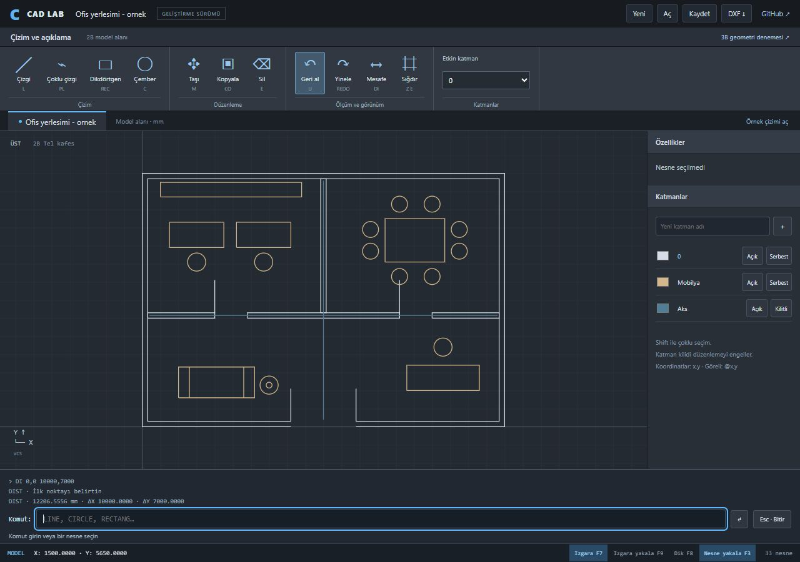

# CAD Lab

Hasan Yahşi tarafından başlatılan bağımsız açık kaynak CAD projesi.
**CAD Lab geçici çalışma adıdır; ürün adı birlikte seçilecek.**

Uzun vadeli hedef: ölçülü eskizler, düzenlenebilir katı modeller, montajlar,
teknik çizimler ve güvenilir dosya alışverişi sunan, çevrimdışı kullanılabilen CAD.
Ticari kullanım için zorunlu abonelik hedeflenmiyor.

Ana uygulama artık AutoCAD tarzı 2B çizim çalışma alanıdır: komut satırı, çizim
nesneleri, katmanlar, nesne seçimi/yakalama, geri al/yinele ve DXF dışa aktarma.
Dört delikli plaka önceki geometri denemesi olarak ayrı tutulur. Tam AutoCAD
eşdeğerliği, montaj ve genel amaçlı kısıt çözücü tamamlanmış özellikler değildir.

Gelişmeler küçük commit'ler, tekrar üretilebilir örnekler ve doğrulama sonuçlarıyla
GitHub'da izlenir. Kişisel web sitesi ve bağlantı sayfalarından ayrı bir projedir.



## Yerelde çalıştırma

Python 3.12 ve Node.js 24 ile Windows PowerShell:

```powershell
python -m venv .venv
.\.venv\Scripts\python.exe -m pip install -r requirements.lock
.\.venv\Scripts\python.exe -m pip install --no-deps -e .
npm --prefix web ci
npm --prefix web run build
.\.venv\Scripts\python.exe -m cad_lab.server
```

Tarayıcıda **http://127.0.0.1:4310** adresini açın. Ana sayfa 2B çizim alanıdır.
3B plaka denemesi `/index.html` adresindedir; buradaki “Modeli oluştur” düğmesi
plaka ölçülerini uygular. Proje dosyası düzenlenebilir veriyi saklar;
STEP dosyası işlem geçmişinin yerine geçmez.

3B denemesinde ok tuşları döndürür, `+`/`-` yakınlaştırır, `F` modeli sığdırır.
Hesap veya bulut geometri servisi gerekmez. Bağımlılıklar kurulduktan sonra model
işlemleri yerelde çalışır. Sunucu yalnız bu bilgisayardan erişilecek şekilde açılır.

Ana sayfada `REC 0,0 100,60` ve `C 20,20 5` komutlarını deneyin. Bir nesneyi seçip
`M 0,0 10,0` yazarak taşıyın. `LINE`, `PLINE`, `CIRCLE`, `RECTANG`, `MOVE`, `COPY`,
`ERASE`, `DIST`, `UNDO`, `REDO` çalışır. LINE/PLINE Enter ile tamamlanır; `C` kapatır,
komut içindeki `U` son noktayı geri alır. Çemberde `D` çap seçeneğidir.
Ondalık ayıracı nokta, koordinat ayıracı virgüldür; göreli giriş `@20,0`, kutupsal
giriş `@50<90` biçimindedir. Shift ile çoklu seçim, orta fare tuşuyla kaydırma yapılır.

2B çizim JSON olarak kaydedilip yeniden açılır; desteklenen çizgi, çoklu çizgi ve
çemberler DXF'e aktarılır. Aynı düzlemsel model-altkümesindeki, mm birimi açıkça
tanımlı ASCII DXF dosyaları da açılır. Desteklenmeyen öğeler mevcut çizim korunarak
reddedilir; aktarım raporunda kapsam belirtilir. DWG, ölçülendirme/pafta, montaj ve
kurulum paketi henüz yok. 3B denemesi `/index.html` adresindedir; STEP/STL çıktısı buradan alınır.
Farklı bir CAD programında doğrulama ve gerçek kullanıcı karşılaştırması bekliyor.

Google Antigravity'deki Gemini 4 Argon High incelemesinin uygulanmış sonuçları:
[ortak inceleme notları](docs/REVIEW-RESULTS.md).

**Aç** ile [ofis örneğini](examples/office-layout.cadlab.json) yükleyebilirsiniz:
10 × 7 metre yerleşim, mm koordinatları, 33 düzenlenebilir nesne ve üç katman içerir.
Mobilyayı taşıyıp geri alın; kilitli akslara dokunmadan duvar çizgilerini düzenleyin.
Bu basitleştirilmiş taslak bir uygulama örneğidir; inşaat uygulama projesi değildir.
Izgara yakınlaştırmaya göre okunabilir 1/2/5 aralıklarına uyarlanır; ızgara yakalama
görünen aralığı kullanır. Komutla girilen koordinatlar mm hassasiyetini korur.

Soldan sağa sürükleyerek tamamen içerideki nesneleri seçin; sağdan sola sürükleme,
pencereyle gerçekten kesişen nesneleri de seçer. Boş çember içini taramak çemberi seçmez.

- [Yol haritası](docs/ROADMAP.md)
- [Teknik kararlar](docs/DECISIONS.md)
- [Bağımlılık ve lisanslar](THIRD_PARTY.md)
